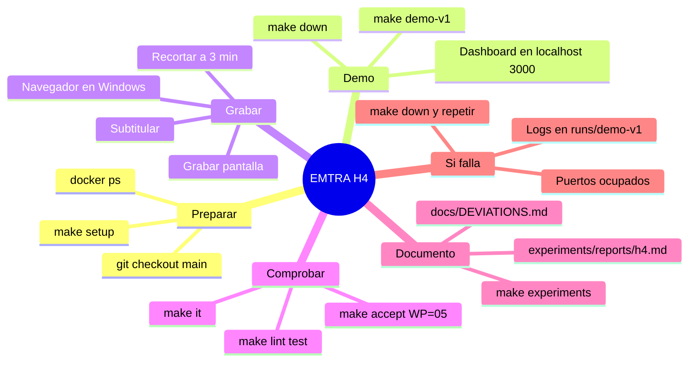

# RUNBOOK — levantar, comprobar y grabar

Guía de operación para humanos. Hito 4 completo; el hito 5 se añade al final cuando exista `make demo-final`.

Todo se ejecuta desde la raíz del repo, en WSL.

## Mapa



## 1. Preparar (una vez por máquina)

| Paso | Comando | Qué esperar |
|---|---|---|
| Docker arrancado | `docker ps` | Lista (aunque esté vacía), sin error |
| Dependencias | `make setup` | `uv sync` sin errores |
| Rama correcta | `git checkout main` | Con WP0–WP6 mezclados |

## 2. Lanzar la demo

```bash
make demo-v1
```

Un solo comando. Hace, en orden:

1. Mata procesos EMTRA de ejecuciones anteriores.
2. Recrea la infraestructura (Mosquitto, TimescaleDB, Grafana) con volúmenes limpios.
3. Vacía sesiones MQTT y tablas; recarga paradas y horario.
4. Arranca Ingestor y Monitor.
5. Imprime la URL del dashboard y arranca el mundo a 60×.
6. Comprueba que la alerta esperada está en FogStore.

Dura unos 5 minutos de reloj. Termina con `demo-v1 OK` y **deja el stack levantado**.

Dashboard: <http://localhost:3000/d/emtra-operator> (sin usuario; acceso anónimo de solo lectura).

Parar todo:

```bash
make down
```

## 3. Línea de tiempo de la demo

El mundo simula de 06:00 a 10:15. Un minuto de reloj es una hora simulada.

| Reloj (desde que arranca el mundo) | Hora simulada | Qué pasa |
|---|---|---|
| 0:00 – 1:00 | 06:00 – 07:00 | Calentamiento. No se enseña. |
| 1:00 – 2:00 | 07:00 – 08:00 | Servicio normal, sin alertas. |
| 2:00 | 08:00 | Empieza la ralentización en el tramo 1. |
| 2:00 – 3:00 | 08:00 – 09:00 | El indicador empeora y salta la alerta `action_required`. |
| 3:00 – 4:15 | 09:00 – 10:15 | Recuperación y cierre de bandas. |

La semilla de la demo y la hora exacta de la alerta están en el último REPORT que las tocó (`docs/plan/reports/WP-06-REPORT.md`, y antes `WP-05-REPORT.md`). La semilla vive en `config/data_split.yaml`; el fallo, en `config/demo/faults_v1.yaml`.

## 4. Grabar el vídeo (≤ 3 min, subtitulado)

1. Ensayo sin grabar: `make demo-v1` y mira el dashboard entero una vez. Comprueba colores de nivel de servicio, las 12 paradas en el mapa y la alerta en su panel.
2. Abre el dashboard en el navegador **de Windows** (el `localhost` de WSL se ve desde Windows). Pantalla completa, modo quiosco de Grafana (icono de monitor arriba a la derecha).
3. Empieza a grabar la pantalla (Barra de juego de Windows con `Win+Alt+R`, u OBS).
4. Lanza `make demo-v1` en el terminal. Cuando imprima la URL, recarga el dashboard.
5. Deja correr hasta `demo-v1 OK`. Para la grabación.
6. Recorta: fuera el calentamiento y la cola. Tramo útil: de 07:30 a 09:30 simuladas, unos 2 minutos. El resto del tiempo, hasta 3 min, para una portada con la arquitectura.
7. Subtítulos con el guion de abajo.

El mapa necesita internet para las teselas. En la presentación se usa el vídeo, no la demo en directo.

### Guion para subtítulos

1. Corredor simulado de 12 paradas y 3 líneas. El simulador publica estimaciones de llegada cada 30 s, como la API de EMT.
2. El Ingestor deriva las llegadas reales a partir de esas estimaciones.
3. El Monitor calcula la regularidad (c_vh) en líneas de alta frecuencia y la puntualidad (OTP) en las de baja, por tramo y banda de 15 minutos.
4. 07:00–08:00: servicio normal, sin alertas.
5. 08:00: ralentización en el tramo 1. Afecta a todas las líneas que lo cruzan.
6. Los detectores EWMA y CUSUM señalan la deriva y se abre una alerta que requiere acción.
7. La alerta se cierra cuando el indicador vuelve a su rango.

No enseñar: el tramo 2 de la línea 19, que oscila por la dispersión natural del corredor. Encuadra el tramo 1.

## 5. Comprobaciones

| Comando | Qué prueba | Duración |
|---|---|---|
| `make lint test` | Estilo, tipos y tests unitarios (sin Docker) | < 30 s |
| `make it` | Integración contra el compose | minutos |
| `make accept WP=05` | La demo dos veces y que dan lo mismo | ~10 min |
| `make accept WP=04` | Indicador, detectores y alertas | ~2 min |

## 6. Material para el documento H4

| Comando / fichero | Contenido |
|---|---|
| `make experiments` | Ejecuta la validación (E1, E2); unos 20 s |
| `experiments/reports/h4.md` | Tabla de KPIs medidos frente a objetivo |
| `docs/plan/reports/WP-0X-REPORT.md` | Resultados y limitaciones por paquete |
| `docs/DEVIATIONS.md` | Cambios respecto al H3, en inglés, para pegar |
| `make baseline` | Regenera línea base, residuos y umbrales (solo si cambia el simulador) |

## 7. Si algo falla

| Síntoma | Qué hacer |
|---|---|
| `make demo-v1` se queda colgado o falla a medias | `make down` y repetir. El script parte siempre de estado limpio. |
| No sale la alerta o el check final falla | Mirar `runs/demo-v1/ingestor.log` y `runs/demo-v1/reliability_monitor.log` |
| Dashboard vacío | Recargar; comprobar que el rango de tiempo es el de la demo y no "últimos 5 minutos" |
| Puerto ocupado (1883, 5432, 3000, 9092) | `docker ps` y parar el contenedor ajeno, o `make down` |
| Resultados raros entre ejecuciones | Procesos huérfanos: `scripts/demo_v1.sh stop` |
| Nada llega a Kafka tras borrar el volumen a mano (`docker compose down -v`) | El outbox del puente conserva sus filas enviadas y por eso ignora los `msg_id` repetidos: borrar `data/bridge` y `data/lake` con el puente y el sink parados (`make demo-v1` ya lo hace) |
| El mapa sale gris | No hay internet para las teselas; los datos están bien |

## 8. Hito 5 (pendiente)

Se añadirá aquí cuando WP12 esté hecho: `make demo-final`, Kafka y puente, decisión del operador, hold aplicado, recuperación, `make dbt`, `make calibrate` y `make it-resilience`.
