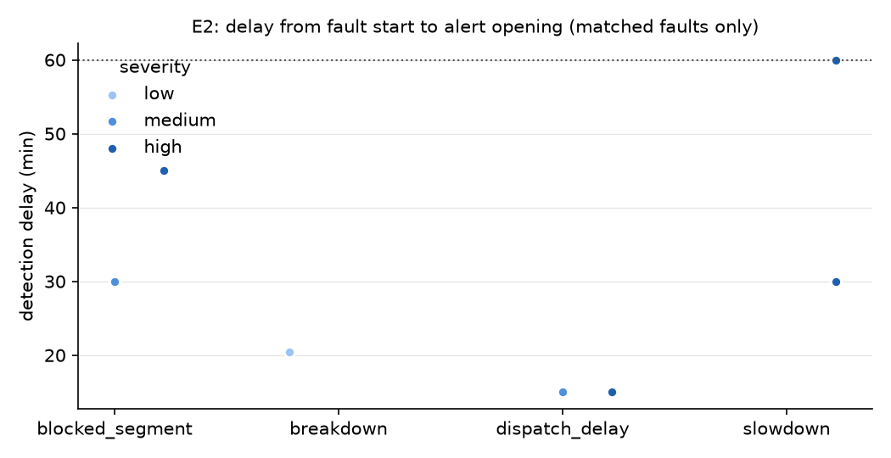

# H4 validation — full

Measured in batch against the simulator's truth. Targets: `config/kpis.yaml`. A KPI in FAIL is reported as it is.

## E1 — no faults: F1 and F3

| KPI | Measure | Value | 95 % CI | n | Target | |
|---|---|---|---|---|---|---|
| K1 | Share of emitted estimates that reach the register | 1 ratio | [1, 1] | 632216 | >= 0.99 ratio | **PASS** |
| K2 | Derived arrival error, p95 of \|derived - true\| | 14.5 s | — | 30902 | <= 15 s | **PASS** |
| K3 | False never-fulfilled (had a true arrival); fault-free and faulty days | 0.926 ratio | [0.888, 0.952] | 270 | <= 0.01 ratio | **FAIL** |
| K4 | Indicator error, MAE of c_vh vs c_vh from true arrivals | 0.00903 c_vh | [0.00889, 0.00918] | 2158 | <= 0.05 c_vh | **PASS** |

## E2 — detection: F9

| KPI | Measure | Value | 95 % CI | n | Target | |
|---|---|---|---|---|---|---|
| K5 | Detection recall (medium/high slowdown and blocked_segment) | 0.438 ratio | [0.231, 0.668] | 16 | >= 0.8 ratio | **FAIL** |
| K6 | Detection delay, median of t_open - t0 | 30 min | [30, 45] | 7 | <= 30 min | **PASS** |
| K7 | False alerts per line, direction and week | 0.333 alerts | [0.0833, 0.667] | 20 | <= 1 alerts | **PASS** |
| K8 | Recall EWMA+CUSUM minus Shewhart at the same ARL0 | 0.0625 recall difference | — | 16 | >= 0 recall difference | **PASS** |
| K17 | action_required alerts per service hour | 0.0111 alerts/h | [0.00278, 0.0222] | 20 | <= 2 alerts/h | **PASS** |

K8 detail: recall EWMA+CUSUM 0.438 vs Shewhart 0.375; false alerts per line·direction·week 0.333 vs 0.167 (the three detectors are tuned to the same ARL0 on the baseline residuals).

### Detection matrix (TP / FN / FP per fault type and severity)

FP = alerts without a matched fault in those runs; `clean` = fault-free days. `breakdown`, `dispatch_delay` and `demand_surge` have no detection target.

| type | severity | faults | TP | FN | FP |
|---|---|---|---|---|---|
| blocked_segment | high | 4 | 2 | 2 | 3 |
| blocked_segment | low | 4 | 0 | 4 | 1 |
| blocked_segment | medium | 4 | 2 | 2 | 2 |
| breakdown | high | 4 | 0 | 4 | 1 |
| breakdown | low | 4 | 1 | 3 | 2 |
| breakdown | medium | 4 | 0 | 4 | 2 |
| clean | - | 0 | 0 | 0 | 4 |
| demand_surge | high | 4 | 0 | 4 | 1 |
| demand_surge | low | 4 | 0 | 4 | 1 |
| demand_surge | medium | 4 | 0 | 4 | 1 |
| dispatch_delay | high | 4 | 2 | 2 | 3 |
| dispatch_delay | low | 4 | 0 | 4 | 2 |
| dispatch_delay | medium | 4 | 1 | 3 | 3 |
| slowdown | high | 4 | 3 | 1 | 1 |
| slowdown | low | 4 | 0 | 4 | 1 |
| slowdown | medium | 4 | 0 | 4 | 1 |

### Recall of the K5 population by segment (medium/high faults)

| type | segment | faults | TP |
|---|---|---|---|
| blocked_segment | 1 | 4 | 4 |
| blocked_segment | 2 | 4 | 0 |
| slowdown | 1 | 4 | 2 |
| slowdown | 2 | 4 | 1 |

### E2 by fault type, severity, segment and hour (no relocation)

Detected = a matched alert of any level. Effect on the truth, independent of the detector: mean difference between the fault run and the same seed without fault, of the true c_vh (HF terns, Δc_vh > 0 is worse) and the true OTP (LF terns, ΔOTP < 0 is worse) of the affected segment (the fault's line if it has one, else every line of the segment), over the complete 15-min bands inside the hour after t0. `pairs` = (tern, band) pairs averaged.

| type | severity | segment | hour | detected/n | median delay (min) | Δc_vh (pairs) | ΔOTP (pairs) |
|---|---|---|---|---|---|---|---|
| blocked_segment | low | 1 | 07 | 0/1 | — | +0.000 (8) | +0.000 (4) |
| blocked_segment | low | 1 | 08 | 0/1 | — | +0.000 (8) | +0.000 (4) |
| blocked_segment | low | 2 | 08 | 0/1 | — | +0.000 (8) | — |
| blocked_segment | low | 2 | 09 | 0/1 | — | +0.002 (8) | — |
| blocked_segment | medium | 1 | 07 | 1/1 | 30 | +0.000 (8) | +0.000 (4) |
| blocked_segment | medium | 1 | 08 | 1/1 | 30 | +0.000 (8) | +0.000 (4) |
| blocked_segment | medium | 2 | 08 | 0/1 | — | +0.024 (8) | — |
| blocked_segment | medium | 2 | 09 | 0/1 | — | +0.001 (8) | — |
| blocked_segment | high | 1 | 07 | 1/1 | 45 | +0.000 (8) | +0.000 (4) |
| blocked_segment | high | 1 | 08 | 1/1 | 45 | +0.000 (8) | +0.000 (4) |
| blocked_segment | high | 2 | 08 | 0/1 | — | +0.136 (7) | — |
| blocked_segment | high | 2 | 09 | 0/1 | — | +0.094 (8) | — |
| breakdown | low | 1 | 07 | 0/1 | — | +0.089 (3) | — |
| breakdown | low | 1 | 08 | 1/1 | 20.4 | +0.200 (3) | — |
| breakdown | low | 1 | 09 | 0/2 | — | +0.112 (3) | -0.125 (3) |
| breakdown | medium | 1 | 07 | 0/1 | — | +0.108 (3) | — |
| breakdown | medium | 1 | 08 | 0/1 | — | +0.229 (3) | — |
| breakdown | medium | 1 | 09 | 0/2 | — | +0.079 (3) | -0.143 (3) |
| breakdown | high | 1 | 07 | 0/1 | — | +0.046 (3) | — |
| breakdown | high | 1 | 08 | 0/1 | — | +0.133 (3) | — |
| breakdown | high | 1 | 09 | 0/2 | — | +0.071 (3) | +0.000 (3) |
| demand_surge | low | 1 | 07 | 0/1 | — | +0.005 (8) | +0.000 (4) |
| demand_surge | low | 1 | 08 | 0/1 | — | -0.001 (8) | +0.000 (4) |
| demand_surge | low | 2 | 08 | 0/1 | — | +0.001 (8) | — |
| demand_surge | low | 2 | 09 | 0/1 | — | +0.000 (8) | — |
| demand_surge | medium | 1 | 07 | 0/1 | — | +0.005 (8) | +0.000 (4) |
| demand_surge | medium | 1 | 08 | 0/1 | — | +0.007 (8) | +0.000 (4) |
| demand_surge | medium | 2 | 08 | 0/1 | — | +0.001 (8) | — |
| demand_surge | medium | 2 | 09 | 0/1 | — | -0.004 (8) | — |
| demand_surge | high | 1 | 07 | 0/1 | — | +0.011 (8) | +0.000 (4) |
| demand_surge | high | 1 | 08 | 0/1 | — | +0.005 (8) | +0.000 (4) |
| demand_surge | high | 2 | 08 | 0/1 | — | +0.007 (8) | — |
| demand_surge | high | 2 | 09 | 0/1 | — | +0.004 (8) | — |
| dispatch_delay | low | 1 | 07 | 0/1 | — | +0.015 (4) | — |
| dispatch_delay | low | 1 | 08 | 0/1 | — | +0.095 (4) | — |
| dispatch_delay | low | 1 | 09 | 0/2 | — | +0.016 (3) | -0.133 (3) |
| dispatch_delay | medium | 1 | 07 | 0/1 | — | +0.083 (4) | — |
| dispatch_delay | medium | 1 | 08 | 0/1 | — | +0.164 (4) | — |
| dispatch_delay | medium | 1 | 09 | 1/2 | 15 | +0.058 (3) | -0.306 (3) |
| dispatch_delay | high | 1 | 07 | 0/1 | — | +0.178 (4) | — |
| dispatch_delay | high | 1 | 08 | 1/1 | 15 | +0.230 (4) | — |
| dispatch_delay | high | 1 | 09 | 1/2 | 15 | +0.086 (3) | -0.291 (3) |
| slowdown | low | 1 | 07 | 0/1 | — | +0.005 (8) | +0.000 (4) |
| slowdown | low | 1 | 08 | 0/1 | — | +0.019 (8) | +0.000 (4) |
| slowdown | low | 2 | 08 | 0/1 | — | -0.015 (8) | — |
| slowdown | low | 2 | 09 | 0/1 | — | +0.037 (8) | — |
| slowdown | medium | 1 | 07 | 0/1 | — | +0.030 (8) | -0.167 (4) |
| slowdown | medium | 1 | 08 | 0/1 | — | +0.059 (8) | -0.142 (4) |
| slowdown | medium | 2 | 08 | 0/1 | — | +0.006 (8) | — |
| slowdown | medium | 2 | 09 | 0/1 | — | +0.038 (8) | — |
| slowdown | high | 1 | 07 | 1/1 | 30 | +0.070 (7) | -0.429 (3) |
| slowdown | high | 1 | 08 | 1/1 | 30 | +0.167 (8) | -0.517 (4) |
| slowdown | high | 2 | 08 | 0/1 | — | +0.066 (8) | — |
| slowdown | high | 2 | 09 | 1/1 | 60 | +0.124 (8) | — |

---
Seeds: E1 clean 3000–3009; E2CTL clean 3030–3033; E2 clean 3010–3029, faults 3030, 3031, 3032, 3033. Runs: E1 10, E2CTL 4, E2 80. Git: 24c67d1 (+ uncommitted changes).
