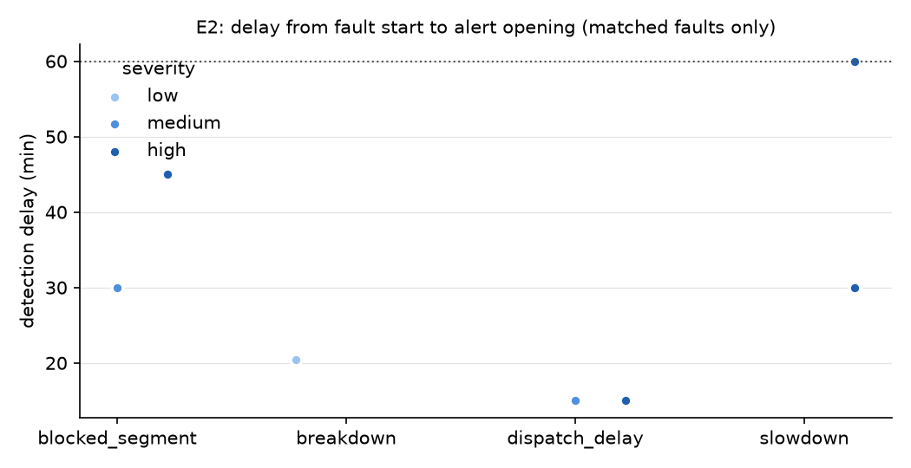

# H4 validation — SMOKE (reduced)

Measured in batch against the simulator's truth. Targets: `config/kpis.yaml`. A KPI in FAIL is reported as it is.

## E1 — no faults: F1 and F3

| KPI | Measure | Value | 95 % CI | n | Target | |
|---|---|---|---|---|---|---|
| K1 | Share of emitted estimates that reach the register | 1 ratio | [1, 1] | 126435 | >= 0.99 ratio | **PASS** |
| K2 | Derived arrival error, p95 of |derived - true| | 14.5 s | — | 6178 | <= 15 s | **PASS** |
| K3 | False never-fulfilled (had a true arrival) | 0 ratio | — | 0 | <= 0.01 ratio | **N/A** |
| K4 | Indicator error, MAE of c_vh vs c_vh from true arrivals | 0.0091 c_vh | [0.0089, 0.00931] | 430 | <= 0.05 c_vh | **PASS** |

## E2 — detection: F9

| KPI | Measure | Value | 95 % CI | n | Target | |
|---|---|---|---|---|---|---|
| K5 | Detection recall (medium/high slowdown and blocked_segment) | 0.75 ratio | [0.301, 0.954] | 4 | >= 0.8 ratio | **FAIL** |
| K6 | Detection delay, median of t_open - t0 | 30 min | [30, 45] | 3 | <= 30 min | **PASS** |
| K7 | False alerts per line, direction and week | 1.67 alerts | [1.67, 1.67] | 2 | <= 1 alerts | **FAIL** |
| K8 | Recall EWMA+CUSUM minus Shewhart at the same ARL0 | -0.25 recall difference | — | 4 | >= 0 recall difference | **FAIL** |
| K17 | action_required alerts per service hour | 0.0556 alerts/h | [0.0556, 0.0556] | 2 | <= 2 alerts/h | **PASS** |

K8 detail: recall EWMA+CUSUM 0.75 vs Shewhart 1; false alerts per line·direction·week 1.67 vs 0.833 (the three detectors are tuned to the same ARL0 on the baseline residuals).

### Detection matrix (TP / FN / FP per fault type and severity)

FP = alerts without a matched fault in those runs; `clean` = fault-free days. `breakdown`, `dispatch_delay` and `demand_surge` have no detection target.

| type | severity | faults | TP | FN | FP |
|---|---|---|---|---|---|
| blocked_segment | high | 1 | 1 | 0 | 1 |
| blocked_segment | low | 1 | 0 | 1 | 0 |
| blocked_segment | medium | 1 | 1 | 0 | 0 |
| clean | - | 0 | 0 | 0 | 2 |
| slowdown | high | 1 | 1 | 0 | 0 |
| slowdown | low | 1 | 0 | 1 | 0 |
| slowdown | medium | 1 | 0 | 1 | 0 |

---
Seeds: E1 3000–3001; E2 3010–3030. Runs: E1 2, E2 8. Git: a2aeb72 (+ uncommitted changes).
